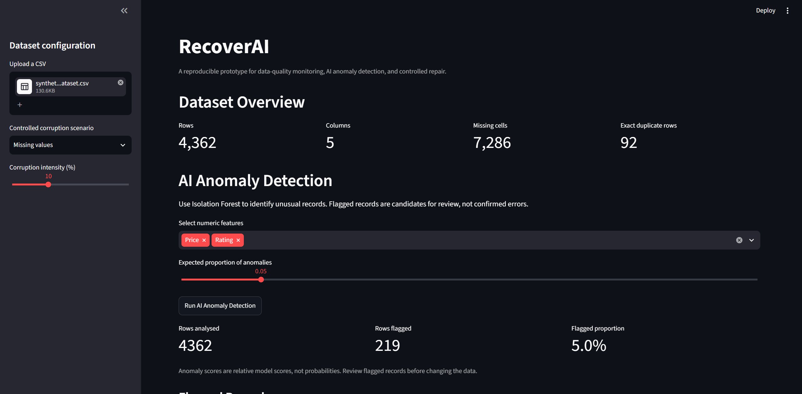
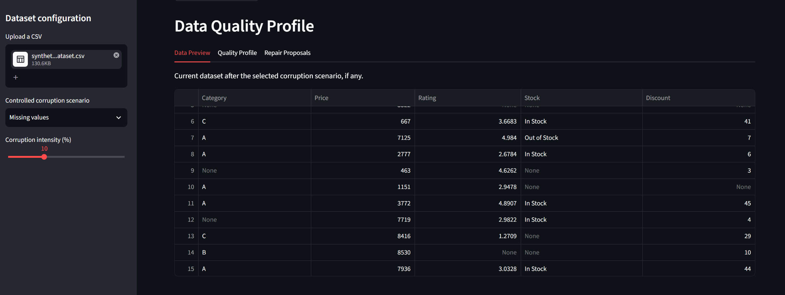
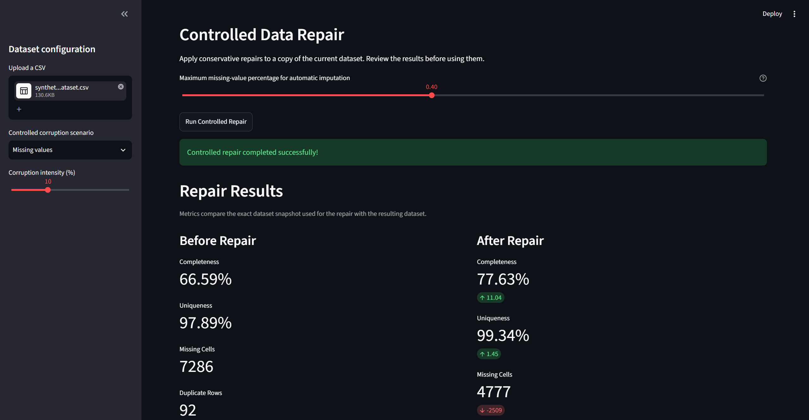
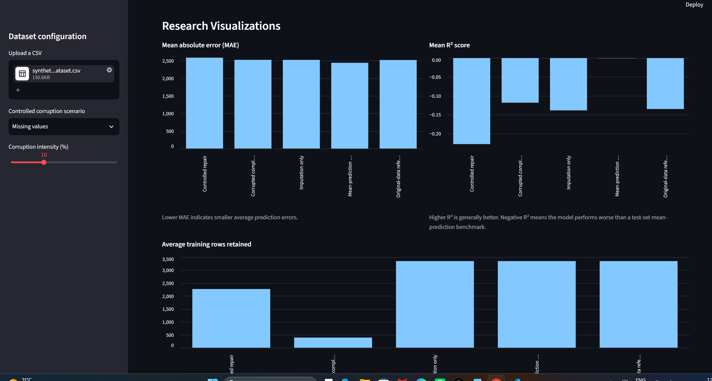

# RecoverAI - Data Quality, Repair & ML Impact Evaluation

**An interactive data-quality analysis and controlled-repair platform for investigating how data corruption affects machine-learning performance.**

RecoverAI is a Streamlit-based research prototype that profiles datasets, introduces controlled corruption scenarios, detects anomalies, proposes data repairs, records repair actions, and evaluates predictive performance before and after data-quality interventions.

The project focuses on an important question:

> Does improving data quality necessarily improve machine-learning performance?

RecoverAI investigates this question through reproducible experiments and matched model evaluations rather than assuming that every repair is beneficial.
## Project Screenshots









## Key Features

- **Dataset profiling:** Inspect missing values, duplicate records, column statistics, and data-quality indicators.
- **Controlled corruption:** Simulate missing values, duplicate rows, numeric outliers, and feature drift.
- **Anomaly detection:** Use Isolation Forest to identify potentially anomalous records.
- **Controlled data repair:** Apply repair operations with configurable missingness thresholds.
- **Human review:** Flag cases requiring additional review instead of treating every proposed repair as automatically trustworthy.
- **Audit trail:** Record repair actions for inspection and accountability.
- **Before-and-after evaluation:** Compare completeness, uniqueness, missing-cell counts, duplicate records, and dataset size.
- **ML impact evaluation:** Compare a mean-prediction baseline, an original-data reference, complete-case training, imputation, and controlled repair.
- **Research reporting:** Visualize experiment results and export a Markdown report.

## Technology Stack

- Python
- Streamlit
- Pandas and NumPy
- Scikit-learn
- Isolation Forest
- Automated tests with pytest

## Project Workflow

1. Load a CSV dataset or use the built-in sample.
2. Profile the dataset and inspect its initial quality.
3. Select a corruption scenario and configure its intensity.
4. Detect potential anomalies and inspect data-quality issues.
5. Apply controlled repair and review the audit information.
6. Compare data-quality metrics before and after repair.
7. Evaluate the effect on predictive performance using repeated train/test experiments.
8. Review the visualizations and export the experiment report.

## Installation and Execution

### 1. Clone the repository

```bash
git clone https://github.com/hrudayesh43/RecoveryAI.git
cd RecoverAI
```


### 2. Create a virtual environment

```bash
python -m venv .venv
```

Activate it on Windows PowerShell:

```powershell
.\.venv\Scripts\Activate.ps1
```

### 3. Install dependencies

If the repository contains a `requirements.txt` file:

```bash
python -m pip install -r requirements.txt
```

### 4. Run the application

```bash
python -m streamlit run app.py
```

Streamlit will display a local URL in the terminal. Open that address in your browser.

### 5. Run the test suite

```bash
python -m pytest tests -v
```

## Experimental Evaluation

RecoverAI compares several strategies for a regression task:

| Strategy | Purpose |
|---|---|
| Mean-prediction baseline | Establish a simple predictive benchmark |
| Original-data reference | Evaluate the reference training data |
| Corrupted complete-case | Measure performance when incomplete training records are excluded |
| Imputation only | Assess an imputation-based strategy |
| Controlled repair | Evaluate the project's repair workflow |

The evaluation uses repeated train/test runs and reports metrics such as mean absolute error (MAE) and the coefficient of determination (\(R^2\)).

For fair comparison, the experimental workflow is designed to use matched held-out observations across strategies. Repair and preprocessing should be fitted using training data only.

**Interpretation matters:** a change in data-quality metrics does not, by itself, demonstrate an improvement in model performance.

## Preliminary Results

One recorded experiment used the `Price` column as the prediction target, a missing-value corruption setting of 10%, and five repeated runs.

| Strategy | Mean MAE | Mean R² |
|---|---:|---:|
| Mean-prediction baseline | 2441.41 | -0.0006 |
| Original-data reference | 2520.93 | -0.1352 |
| Corrupted complete-case | 2525.69 | -0.1183 |
| Imputation only | 2524.68 | -0.1387 |
| Controlled repair | 2587.35 | -0.2282 |

*These are preliminary results from one experiment, not universal performance claims.*

In this experiment, the mean-prediction baseline achieved the lowest MAE and the highest \(R^2\). All reported \(R^2\) values were negative, indicating that the evaluated models performed worse than the test-set mean predictor under the standard \(R^2\) comparison.

The controlled-repair strategy did not improve predictive performance in this run. This finding motivates further investigation into repair quality, information loss, model choice, and the characteristics of the input dataset.

### Data-quality changes in the same recorded run

| Metric | Before | After |
|---|---:|---:|
| Completeness | 66.59% | 77.63% |
| Uniqueness | 97.89% | 99.34% |
| Missing cells | 7,286 | 4,777 |
| Duplicate rows | 92 | 28 |
| Rows | 4,362 | 4,270 |

These figures show that the repair workflow improved the reported completeness and uniqueness indicators while reducing the number of rows. Because rows were removed and missing cells remained, the results should not be interpreted as proof that every missing value was successfully repaired.

## Limitations

- The sample dataset may contain pre-existing quality issues before additional corruption is introduced.
- A corruption setting is not necessarily equal to the final percentage of missing cells across the entire dataset.
- Results depend on the dataset, corruption mechanism, repair method, target variable, and model configuration.
- The original-data reference is not necessarily a perfectly clean-data benchmark.
- Negative \(R^2\) values and a weak baseline indicate that model suitability and dataset characteristics need further investigation.
- Preliminary experiments do not establish statistical significance or generalizability to other datasets.

## Future Improvements

- Evaluate multiple datasets and prediction tasks.
- Compare additional repair and imputation methods.
- Add stronger data-leakage and reproducibility checks.
- Evaluate uncertainty and statistical significance across repeated experiments.
- Add configurable models and classification metrics.
- Improve repair explanations, provenance, and human-review controls.
- Add continuous integration and broader automated test coverage.

## Research Motivation

RecoverAI explores the relationship between data quality, repair decisions, and downstream machine-learning reliability. Its central objective is to make data-quality interventions observable, auditable, and empirically testable.

Rather than assuming that repaired data is always better for every predictive task, the project treats repair as an intervention whose effects should be measured.

---

**Project status:** Research prototype under active development.

**Author:** Hrudayesh Koyya

**License:** To be specified before public release.
**Link:** https://recoveryai.streamlit.app/ 
